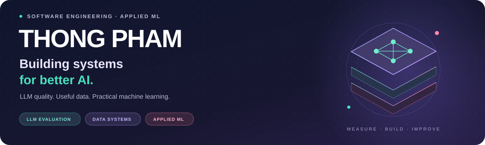
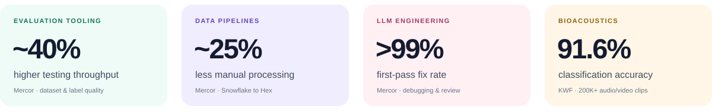

  <picture>
    <source media="(max-width: 600px)" srcset="assets/profile-banner-mobile.svg">
    
  </picture>

  <a href="documents/Thong-Pham-Resume.pdf"><strong>📄 Download my resume</strong></a>
  &nbsp; · &nbsp;
  <a href="https://www.linkedin.com/in/tpdatascience/"><strong>💬 Connect on LinkedIn</strong></a>
  &nbsp; · &nbsp;
  <a href="mailto:ThongPhamBusiness@gmail.com"><strong>✉️ Say hello</strong></a>

## 👋 A little about me

I'm **Thong**, a software engineer based in **Las Vegas, Nevada**, working at the
intersection of **LLM evaluation, data infrastructure, and applied machine learning**.

At **Mercor**, I build Python tooling, evaluation workflows, and data pipelines
that help AI teams measure quality and work more efficiently. My background spans
bioacoustic classification, LLM-powered finance tools, and machine learning
experiments — with an economics foundation that keeps the focus on useful results.

  <picture>
    <source media="(max-width: 600px)" srcset="assets/impact-mobile.svg">
    
  </picture>

## ⚡ What I bring to the work

| Focus | What that looks like |
| --- | --- |
| **LLM evaluation & quality** | Model API integrations, dataset validation, acceptance criteria, reviewer feedback, and regression checks. |
| **Data systems & tooling** | Python automation, Snowflake-to-Hex pipelines, Airtable workflows, and dashboards for model performance and label coverage. |
| **Applied machine learning** | Classification with PyTorch, XGBoost, and OpenCV; feature selection, model interpretability, and experimentation. |

## 🚀 Explore my projects

| Project | Why explore it |
| --- | --- |
| [**Kaggle experiments**](https://github.com/YouKnowJP/Kaggle) | Notebooks spanning bioacoustics, healthcare, loan repayment, NLP, computer vision, agriculture, and time-series forecasting. |
| [**Machine learning from the ground up**](https://github.com/YouKnowJP/Machine-Learning-Project) | Neural networks and regression implementations, plus Dino and Snake with deep Q-learning and Pong with NEAT. |
| [**Switchback & personal projects**](https://github.com/YouKnowJP/Personal-Project) | A browser Snake game with phase-switching puzzles, campaign play, and arcade modes. |

## 🧭 My path so far

**Mercor · Software Engineer & Tooling** 
*March 2025 - Present · San Francisco, CA*

Built LLM evaluation tooling and end-to-end labeling workflows, including quality
checks that maintained **under 1% post-evaluation defect rates**. My LLM engineering
work also spans API debugging, technical specifications, and evaluator review,
with a **20% reduction in feature iteration time**.

**Kashmir World Foundation · Machine Learning Engineer Intern** 
*September 2024 - February 2025 · Richmond, VA*

Worked with **over 200,000 audio/video clips** using XGBoost, PyTorch, and OpenCV,
and built dashboards to make modeling insights useful to conservation researchers.

**Stealth Startup · Software Engineer** 
*February 2023 - June 2024 · Irvine, CA*

Delivered LLM-powered finance workflows, evaluation scripts, and a Python
regression test harness to catch recurring issues before deployment.

## 🛠️ Tools I work with

| Area | Stack |
| --- | --- |
| **Programming** | Python · SQL · Java · C/C++ · R |
| **Machine learning** | PyTorch · TensorFlow · Keras · scikit-learn · XGBoost · OpenCV · Seaborn |
| **Data & cloud** | Snowflake · AWS S3 & EC2 · Google Cloud · Hex |
| **Workflow & analytics** | Git & CI/CD · Docker · Airtable · Power BI · Tableau · Excel · Google Sheets & Workspace |

## 🎓 Education & a little more

- **M.S. Computer Science, Machine Learning** — University of Colorado Boulder 
  June 2024 - December 2025 · **GPA 4.0 / 4.0**
- **B.A. Business Economics** — University of California, Irvine 
  September 2019 - December 2022
- **Languages:** English and Vietnamese (native) · Spanish (intermediate)

---

  <strong>Have an interesting engineering problem or want to compare notes?</strong> 
  <a href="mailto:ThongPhamBusiness@gmail.com">Let's connect.</a>

